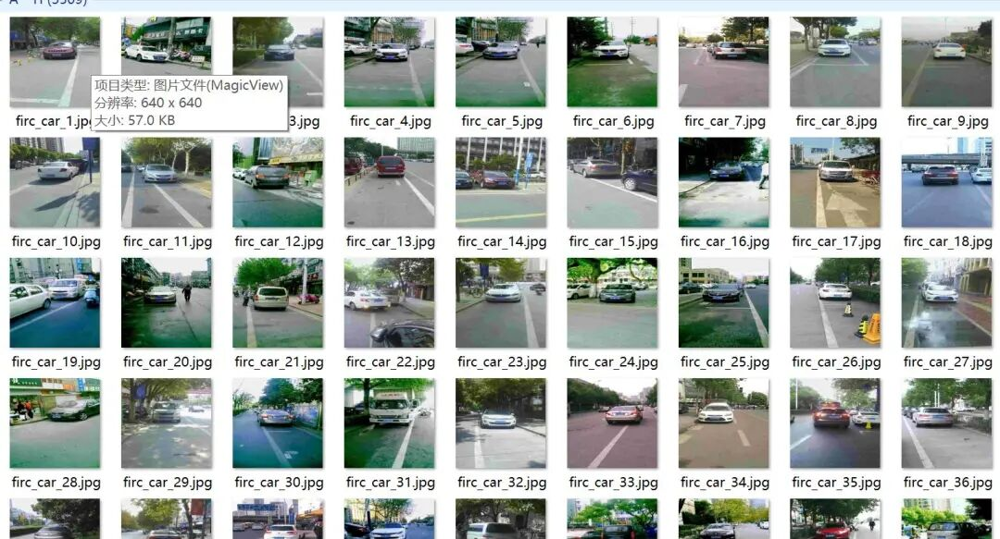
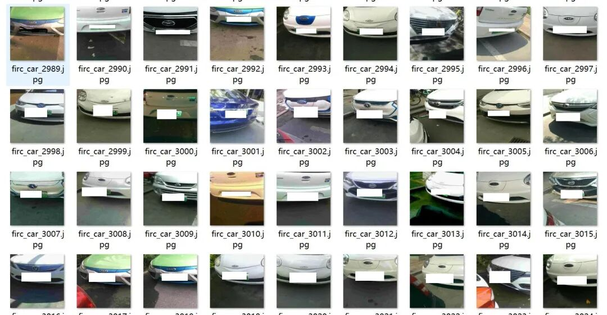
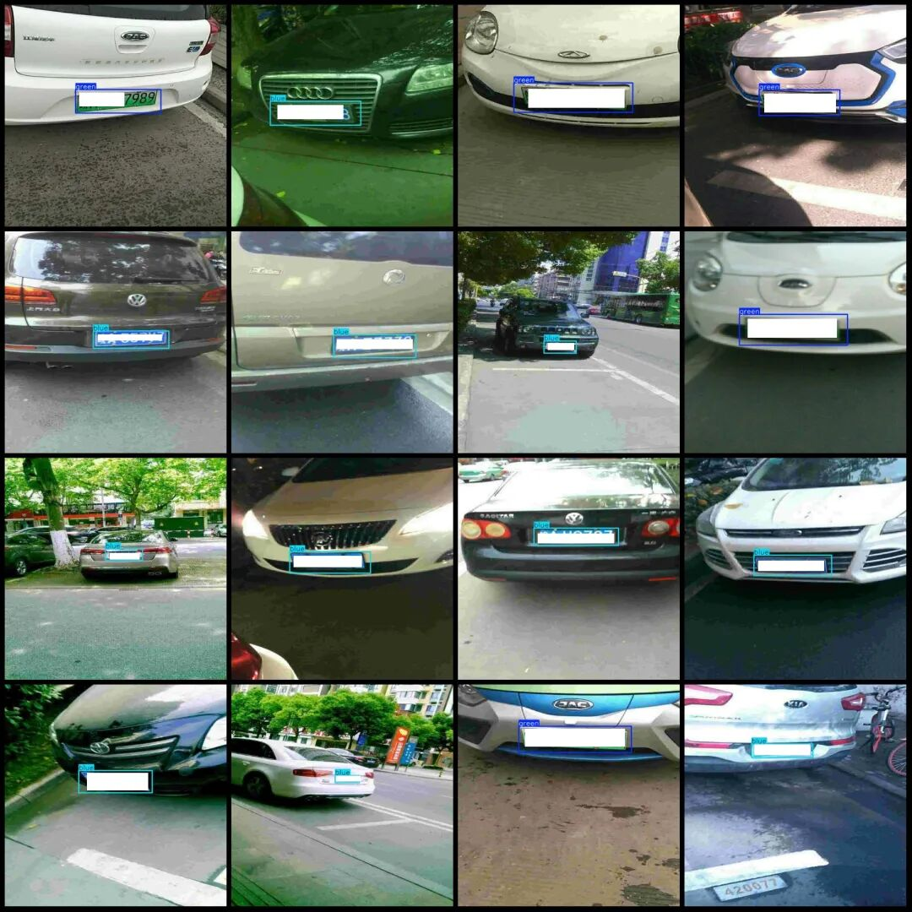
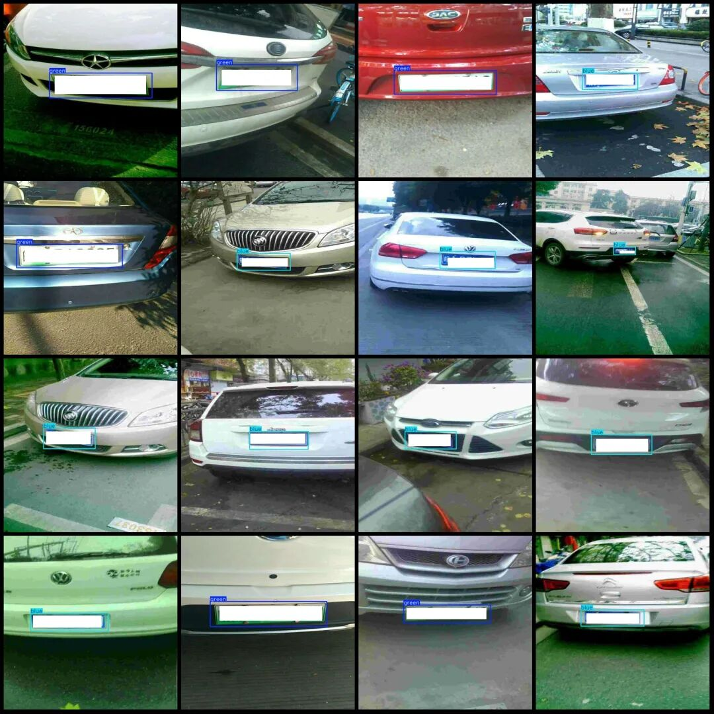

# Dataset for Vehicle License Plates: Blue and Green, New Energy and Oil Cars - VOC+YOLO format with 3509 images in 2 categories

Dataset format: Pascal VOC format + YOLO format (txt file without split path, only containing jpg images and corresponding VOC format xml files and yolo format txt files)

Number of images (number of jpg files): 3509

Number of annotations (number of xml files): 3509

Number of annotations (number of txt files): 3509

Labeling category count: 2

Label category names (Note that the order of categories in the YOLO format does not correspond to this, but is based on the labels folder's classes.txt): ["blue", "green"]

Number of boxes labeled in each category:

Blue frame count = 2518

Green box count = 1003

Total frame count: 3521

Number of images per category:

Blue occupies the number of images = 2508

Green occupies the number of pictures = 1001

Image resolution: 640x640

Using labelImg:

Annotation rules: Draw a rectangle around the category.

Important Notice: The dataset does not have separate training, validation, and test sets; you need to partition them yourself.

Special : This dataset does not guarantee the accuracy of the trained models or weight files.

Image Preview (Actually no occlusion):

Annotation example (actually no occlusion):

## Payment

Here is a pay link on Stripe ( https://buy.stripe.com/3cs8yP7sY87d0vu9AB ). Please contact me lonlonago@foxmail.com after funding $89, and I will send you a complete data files , thank you!

